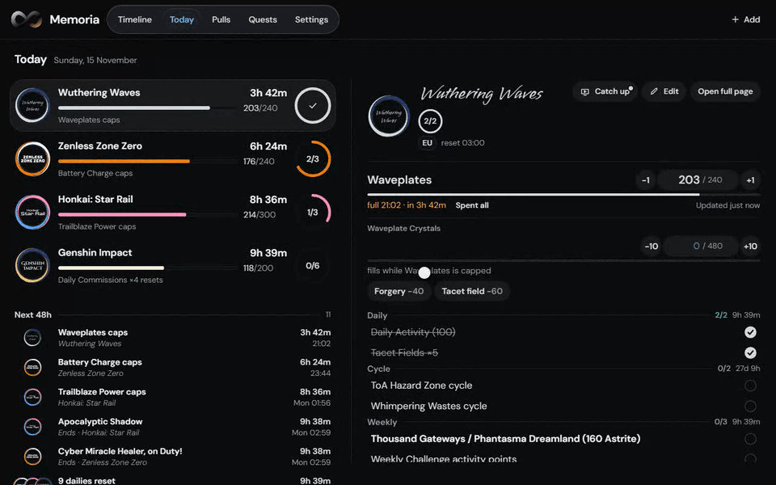
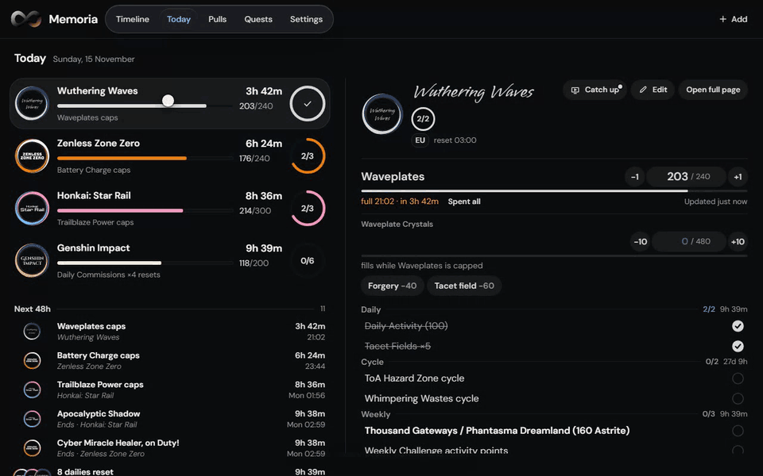
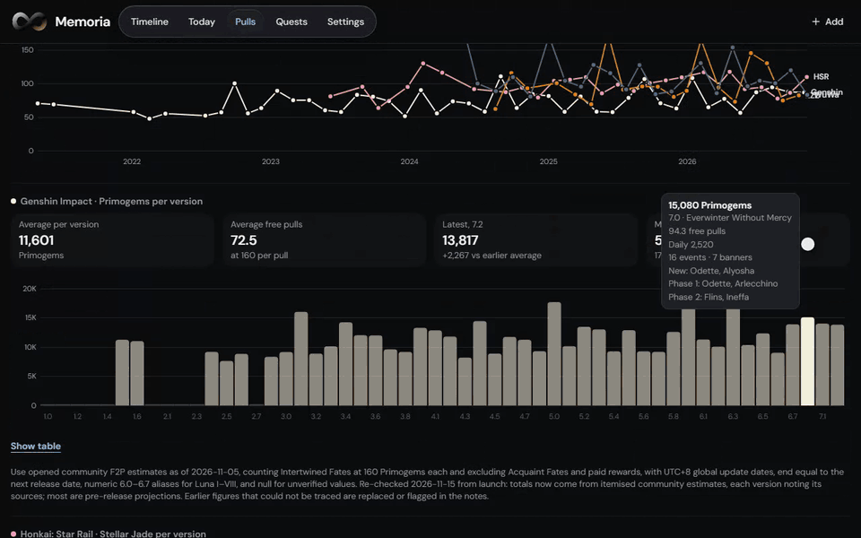
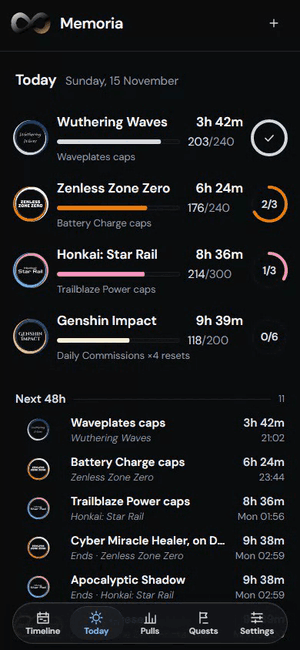
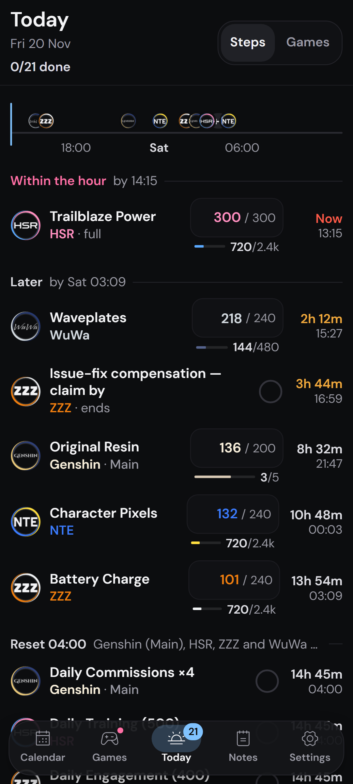
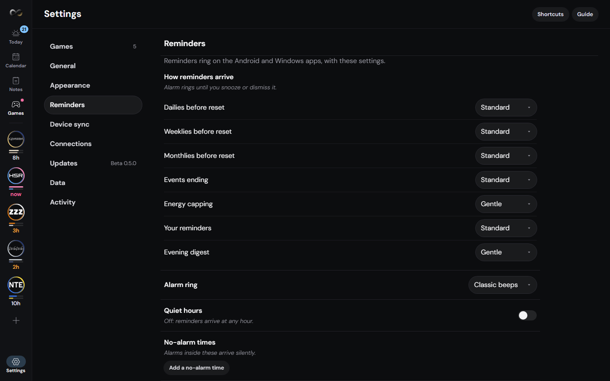

# Memoria

**One dashboard for every gacha you play: what are you about to waste, and when?**

Memoria tracks energy, dailies, weeklies, events and banners across Genshin Impact, Honkai: Star Rail, Zenless Zone Zero, Wuthering Waves, Neverness to Everness, Arknights: Endfield and more, each on its own server clock. It runs on Windows and Android, works offline, needs no account, and never touches your game account: you type what the game shows.

**[Download the latest release](https://github.com/JanKonradK/Memoria/releases/latest)** · [Guide](docs/guide.md) · [Report a problem](https://github.com/JanKonradK/Memoria/issues)

## What it does

- **Today** ranks your games by what is lost first and lists everything that caps, ends or resets in the next two days.
- **Timeline** holds every event, banner, reset and livestream, from a calendar that updates between releases.
- **Quests** follows each game's story: main-story acts, world-quest series and character stories, ticked off part by part, with the characters in each.
- **Pulls** tracks savings and pity, and shows what every version since launch gave a free-to-play player.
- **Reminders** arrive before resets, caps and event ends, as anything from a silent note to a ringing alarm with snooze.
- **Sync** keeps a PC and a phone in step over Wi-Fi, end-to-end encrypted, with no server in between.

### Timeline and Pulls

### Quests

### On a phone, and reminders

  
  

## Install

- **Windows:** download `Memoria-setup-x64.exe` and run it. No administrator prompt; it updates itself. If Windows SmartScreen warns, choose **More info → Run anyway** (the installer is not code-signed yet).
- **Android:** download `Memoria-android.apk` on the phone and open it (Android 7+). Updates install over the existing app, or through [Obtainium](https://obtainium.imranr.dev).

Then add your games, type in your energy, and tick dailies as you finish them. The [guide](docs/guide.md) covers syncing a phone, reminders, backups and the rest.

## Development

React, TypeScript and Vite, with a Rust (Tauri) Windows host and a Capacitor Android app; domain logic lives in `shared/`. See the [developer guide](docs/development.md) and the [roadmap](docs/roadmap.md).
